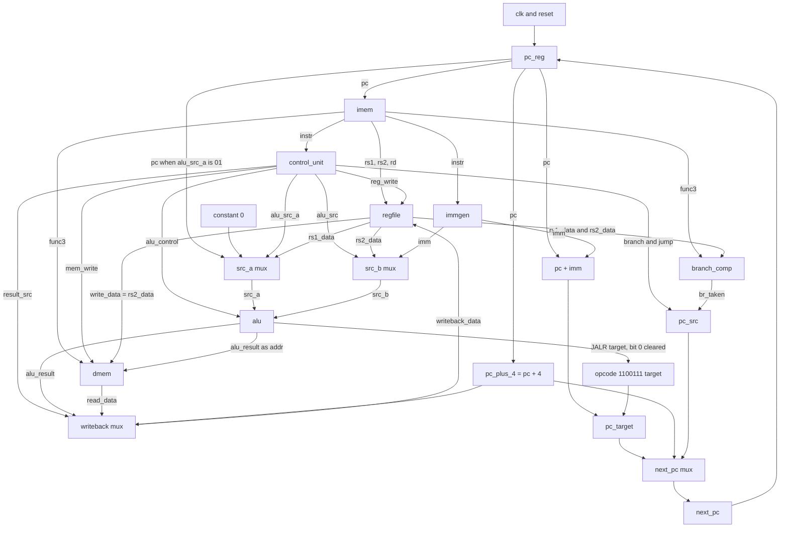

# Single-cycle RV32 processor

This repository contains a single-cycle 32-bit RISC-V core written in Verilog, plus instruction and data memories, a sample program, and several testbenches. The core executes one instruction per clock cycle. The comments in `rv32/riscv_core.v` label the datapath as fetch, decode, execute, memory, and writeback, but those are combinational regions inside the same cycle. There are no pipeline registers between them.

The processor implements the 37 computational instructions of the base RV32I set: integer register and immediate arithmetic, loads, stores, conditional branches, `JAL`, `JALR`, `LUI`, and `AUIPC`. It does not implement `FENCE`, `ECALL`, `EBREAK`, CSR instructions, exceptions, interrupts, or the M, A, F, D, or C extensions. An unmatched opcode does not trap. It leaves the control outputs at their defaults, so the instruction writes neither the register file nor data memory and the PC advances by 4.

The core has no external data ports. `clk` and `reset` are its only inputs. Registers, both memories, the PC, and the current instruction are internal. Testbenches observe them with hierarchical references such as `uut.rf.rf[1]` and `uut.dm.RAM[0]`.

Simulation status, using Icarus Verilog 13.0 on these sources:

- `rv32/tb_riscv_core.v`, compiled with the RTL and run from `rv32/`, printed `Passed: 445`, `Failed: 0`, and `All tests passed.` The run finished at 1556 ns.
- The unit testbenches under `test benches/` were also compiled and run. They are described in [Testbenches](#10-testbench-and-verification). They do not print a pass/fail summary.
- `test benches/riscv_rtype_core_tb.v` does not elaborate. The module it instantiates, `riscv_rtype_core`, is not in the repository.

`vvp` still exits 0 when the self-checking testbench counts failures. Read the `Failed:` line.

## Contents

1. [Project overview](#1-project-overview)
2. [Features and capabilities](#2-features-and-capabilities)
3. [Repository structure](#3-repository-structure)
4. [Processor architecture](#4-processor-architecture)
5. [Module-by-module documentation](#5-module-by-module-documentation)
6. [Instruction-set support](#6-instruction-set-support)
7. [Datapath and control signals](#7-datapath-and-control-signals)
8. [Memory and register organization](#8-memory-and-register-organization)
9. [Reset and clock behavior](#9-reset-and-clock-behavior)
10. [Testbench and verification](#10-testbench-and-verification)
11. [Prerequisites and setup](#11-prerequisites-and-setup)
12. [Compilation and simulation](#12-compilation-and-simulation)
13. [Running a custom instruction program](#13-running-a-custom-instruction-program)
14. [How to write or extend a testbench](#14-how-to-write-or-extend-a-testbench)
15. [Known limitations and potential issues](#15-known-limitations-and-potential-issues)
16. [Troubleshooting](#16-troubleshooting)
17. [Future improvements](#17-future-improvements)

## 1. Project overview

The core is a teaching-scale RV32 datapath. One rising clock edge retires the instruction currently addressed by the PC: it can write one register and one data-memory location, and it loads the next PC. Instruction fetch, decode, the ALU, the branch compare, and the data-memory read are combinational and settle during the cycle before that edge.

| Item | What the RTL implements |
| --- | --- |
| Language | Verilog, with ANSI-style ports and `always @(*)`. No SystemVerilog features are used. |
| XLEN | 32 bits. |
| Cycle model | Single-cycle. One instruction retires per rising edge of `clk`. |
| Instructions | The 37 RV32I instructions listed in [Instruction-set support](#6-instruction-set-support). |
| Registers | 32 registers, `x0` through `x31`, each 32 bits. Reads of `x0` return 0. Writes to `x0` are ignored. |
| Instruction memory | 64 words, loaded in simulation by `$readmemh("program.hex", ROM)`. |
| Data memory | 64 words, separate from instruction memory. Byte, halfword, and word accesses are implemented in `dmem`. |
| Reset | Active-high and asynchronous, and it clears only the PC. |
| External interface | `input wire clk`, `input wire reset`. |

The two memories are independent arrays. A store does not modify instruction memory, and an instruction fetch does not read data memory. Both arrays are indexed by address bits `[7:2]`, so each one holds 256 bytes. Address bits above bit 7 are ignored.

There is no assembler, linker script, Makefile, constraint file, or vendor project in the tree. Programs enter the core as 32-bit instruction words in `rv32/program.hex`, or by writes to `imem.ROM` from a testbench.

## 2. Features and capabilities

Status words used below:

- **Implemented** means the RTL contains the behavior.
- **Verified** means `tb_riscv_core` checks it, and the Icarus run of that bench reported `Failed: 0`.
- **Unverified** means the RTL contains the behavior and that bench does not check it.
- **Partial** means only part of the architectural behavior is present.
- **Unsupported** means the decoder has no case that performs that operation.

### Instruction fetch and execution

| Behavior | Status |
| --- | --- |
| PC register, combinational instruction read, PC+4 sequential fetch | Implemented and verified |
| One instruction retired per rising clock edge | Implemented and verified by the directed programs in `tb_riscv_core` |
| Fetch of a PC that is not a multiple of 4 | Partial. `imem` returns `ROM[pc[7:2]]` and ignores `pc[1:0]`. A probe of `imem` with `program.hex` returned the word at index 0 for both PC 0 and PC 2. `tb_riscv_core` does not check this |
| Fetch of PC 256 and above | Partial. The same probe returned the word at index 0 for PC 256. `tb_riscv_core` does not check aliasing |
| Illegal-instruction trap, `FENCE`, `ECALL`, `EBREAK`, CSR operations | Unsupported. The default control values produce a write-free PC+4 |

### Arithmetic and logical operations

| Behavior | Status |
| --- | --- |
| `ADD`, `SUB`, `SLL`, `SLT`, `SLTU`, `XOR`, `SRL`, `SRA`, `OR`, `AND` | Implemented and verified |
| `ADDI`, `SLTI`, `SLTIU`, `XORI`, `ORI`, `ANDI`, `SLLI`, `SRLI`, `SRAI` | Implemented and verified, including `ADDI` immediates -2048, -1, and 2047 |
| Shift amount | Implemented as `src_b[4:0]`. The bench uses amounts 4 and 31 |
| `SUB` versus `ADD`, and `SRA`/`SRAI` versus `SRL`/`SRLI` | Partial decode. Only `func7[5]` (instruction bit 30) is tested. Other `funct7` bits are ignored |
| `SLL`, `SLLI`, and the other R-type operations besides `SUB` and `SRA` | `funct7` is not checked |
| RV32M (`MUL`, `DIV`, and the rest of opcode `0110011` with `funct7 = 0000001`) | Unsupported as multiply/divide. Those encodings fall through the integer `funct3` map because bit 5 of `0000001` is 0. See [Unmatched and aliased encodings](#unmatched-and-aliased-encodings) |

### Register file

| Behavior | Status |
| --- | --- |
| Combinational read of `rs1` and `rs2`, synchronous write of `rd` | Implemented and verified |
| `x0` reads as 0, including after a hierarchical deposit into `rf[0]` | Implemented and verified |
| Write suppressed when `rd == 0` | Implemented and verified |
| Back-to-back use of a register written by the previous instruction | Implemented and verified by the data-dependency program |
| Hardware clear of the 32 registers | Absent. In simulation an unwritten register reads as `x`, except `x0` |

### Immediate generation

| Behavior | Status |
| --- | --- |
| I-type sign extension, including negative `ADDI` | Implemented and verified |
| S-type store offset | Implemented and verified |
| B-type branch offset, including a negative offset (`blt` with immediate -8) | Implemented and verified |
| J-type offset with a positive immediate | Implemented and verified |
| J-type negative offset | Implemented in `immgen` (sign bit replicated). No directed check in `tb_riscv_core` |
| U-type immediate `{instr[31:12], 12'b0}` for `LUI` and `AUIPC` | Implemented and verified for the immediates in the bench, including `LUI` of `0x80000` |

### Memory access

| Behavior | Status |
| --- | --- |
| `LW` / `SW` | Implemented and verified |
| `LB` / `LBU` / `SB`, including byte lanes at addresses 0, 5, and 255 | Implemented and verified |
| `LH` / `LHU` / `SH` at halfword-aligned addresses 8 and 10 | Implemented and verified |
| Load and store address `rs1 + imm` | Implemented and verified, including a non-zero base (`lw` through `x10`, `sw` through `x14`) |
| Separate instruction and data arrays | Implemented |
| Misaligned-access exception | Unsupported. `LW` ignores `addr[1:0]`. `LH`/`SH` select the halfword with `addr[1]` and ignore `addr[0]` |
| Addresses above 255 | Upper bits are ignored. Not checked by `tb_riscv_core` |
| Data-memory reset or power-on image | Absent. The core bench clears `RAM` before each program |

### Branches, jumps, and upper immediates

| Behavior | Status |
| --- | --- |
| `BEQ`, `BNE`, `BLT`, `BGE`, `BLTU`, `BGEU`, taken and not taken | Implemented and verified |
| Backward `BLT` | Implemented and verified |
| Branch target `pc + imm`, with the B-immediate already shifted in `immgen` | Implemented and verified for the offsets in the bench (8 and -8) |
| `JAL` with a link write of `pc + 4`, and `JAL` with `rd = x0` | Implemented and verified |
| `JALR` target `{rs1 + imm}[31:1]` with bit 0 cleared, link write of `pc + 4` | Implemented and verified for targets 4 and 12 |
| `JALR` whose sum is 2 mod 4 | Bit 0 is cleared, but fetch still uses `pc[7:2]`. Not checked by `tb_riscv_core` |
| `LUI`, `AUIPC` | Implemented and verified |
| `JALR` `funct3` | Not checked. The spec encoding is `000`. Any `funct3` with opcode `1100111` takes the `JALR` control path |

## 3. Repository structure

```
.
├── README.md
├── .vscode/
│   ├── settings.json
│   └── tasks.json
├── rv32/
│   ├── riscv_core.v
│   ├── pc_reg.v
│   ├── imem.v
│   ├── control_unit.v
│   ├── immgen.v
│   ├── regfile.v
│   ├── alu.v
│   ├── branch_comp.v
│   ├── dmem.v
│   ├── program.hex
│   └── tb_riscv_core.v
└── test benches/
    ├── alu_tb.v
    ├── control_unit_tb.v
    ├── pc_reg_tb.v
    ├── regfile_tb.v
    └── riscv_rtype_core_tb.v
```

The directory name `test benches` contains a space. Quote it in shell commands. The Git remote recorded for this clone is `https://github.com/muntasir72/risc-v.git`.

| File | Role | Relationship |
| --- | --- | --- |
| `rv32/riscv_core.v` | Top-level RTL. Module `riscv_core` | Instantiates every other RTL module and contains the muxes for ALU inputs, writeback, and the next PC |
| `rv32/pc_reg.v` | RTL. Module `pc_reg` | Only architectural register updated by reset |
| `rv32/imem.v` | RTL. Module `imem` | Combinational ROM. `$readmemh` loads `program.hex` from the simulator's working directory |
| `rv32/program.hex` | Simulation test data | Fourteen instruction words for the first program in `tb_riscv_core`. Not RTL |
| `rv32/control_unit.v` | RTL. Module `control_unit` | Combinational decoder from opcode, `func3`, and `func7` |
| `rv32/immgen.v` | RTL. Module `immgen` | Combinational immediate decode |
| `rv32/regfile.v` | RTL. Module `regfile` | 32 by 32 register array |
| `rv32/alu.v` | RTL. Module `alu` | Combinational ALU, selected by a 6-bit control |
| `rv32/branch_comp.v` | RTL. Module `branch_comp` | Combinational branch condition |
| `rv32/dmem.v` | RTL. Module `dmem` | 64-word data RAM. Reads are combinational. Writes occur on the rising clock edge |
| `rv32/tb_riscv_core.v` | Self-checking testbench. Module `tb_riscv_core` | Instantiates `riscv_core` and is the bench that exercises the processor |
| `test benches/alu_tb.v` | Monitor-only unit bench | Drives a 3-bit `alu_control` into the 6-bit ALU port |
| `test benches/control_unit_tb.v` | Monitor-only unit bench | Connects a 3-bit `alu_control` and leaves the other control outputs unconnected |
| `test benches/pc_reg_tb.v` | Monitor-only unit bench | Drives `pc_reg` directly |
| `test benches/regfile_tb.v` | Monitor-only unit bench | Writes `x1`, `x2`, and `x3` through the register-file ports |
| `test benches/riscv_rtype_core_tb.v` | Stale bench | Instantiates `riscv_rtype_core`, which is not defined |
| `.vscode/tasks.json` | Editor task configuration | Default build compiles only the file that is open. The waveform task looks for `dump.vcd` |
| `.vscode/settings.json` | Editor spell-check words | No simulation settings |

`iverilog` writes a simulator binary, and `tb_riscv_core` writes `riscv_core_tb.vcd` in the current directory. Those are generated outputs, not source files.

## 4. Processor architecture

`riscv_core` is a single-cycle implementation. While the PC is stable, the instruction memory, decoder, register read ports, immediate generator, ALU, branch comparator, and data-memory read port form a combinational path. The rising edge of `clk` does three updates together:

1. `pc_reg` loads `next_pc`, unless `reset` is asserted.
2. `regfile` writes `writeback_data` to `rd` when `reg_write` is 1 and `rd` is not 0.
3. `dmem` writes `rs2_data` into the addressed lane when `mem_write` is 1 and `func3` selects `SB`, `SH`, or `SW`.

The next instruction then sees the register and memory values produced by that edge. A result forwarded to the following instruction does not need a bypass network. The data-dependency program in `tb_riscv_core` relies on this.



### Execution flow

**1. PC update and instruction fetch.** `pc_reg` holds `pc`. After reset, `pc` is 0. `imem` returns `ROM[pc[7:2]]` with an `assign`, so the fetch is not clocked. `pc_plus_4` is `pc + 4`.

**2. Decode.** `control_unit` reads `instr[6:0]`, `instr[14:12]`, and `instr[31:25]`. Its outputs are combinational.

**3. Register operands.** `regfile` reads `instr[19:15]` and `instr[24:20]` combinationally. The read of register 0 is forced to 0.

**4. Immediate.** `immgen` builds a 32-bit `imm` from the same instruction. R-type instructions still produce an I-type-shaped immediate, and the core ignores it because `alu_src` is 0.

**5. ALU.** `src_a` is `rs1_data` when `alu_src_a` is `00`, the PC when `alu_src_a` is `01`, and 0 for any other value. `src_b` is `imm` when `alu_src` is 1 and `rs2_data` when `alu_src` is 0. `alu` is combinational.

**6. Memory.** `dmem` uses `alu_result` as the byte address and `instr[14:12]` as the access width. The read port is combinational, so a load's data is available in the same cycle and is written into `rd` on that cycle's rising edge. Stores present `rs2_data` as `write_data` and commit on that same edge.

**7. Writeback.** `result_src` selects `alu_result` (`00`), `read_data` (`01`), or `pc_plus_4` (any other value, including the `10` used by `JAL` and `JALR`).

**8. Next PC.** `branch_comp` compares the two register values. `pc_src` is `jump | (branch & br_taken)`. When `pc_src` is 0, `next_pc` is `pc_plus_4`. When `pc_src` is 1, `next_pc` is `pc_target`. For opcode `1100111` (`JALR`), `pc_target` is `alu_result` with bit 0 cleared. For every other opcode, `pc_target` is `pc + imm`. Branches and `JAL` use that second form. Their immediates already contain the architectural low zero bit.

`JALR` is recognized in `riscv_core` by comparing the opcode, in addition to the `jump` bit from the control unit. Both are set for opcode `1100111`.

## 5. Module-by-module documentation

### `riscv_core` (`rv32/riscv_core.v`)

Top-level processor. Ports:

| Port | Direction | Width | Meaning |
| --- | --- | --- | --- |
| `clk` | input | 1 | Rising edge retires one instruction |
| `reset` | input | 1 | Active-high asynchronous PC clear. Passed only to `pc_reg` |

Internal nets:

| Net | Width | Meaning |
| --- | --- | --- |
| `pc`, `next_pc`, `pc_plus_4`, `pc_target` | 32 | Current PC, value loaded at the next edge, `pc + 4`, and the branch/jump target |
| `instr` | 32 | Instruction word from `imem` |
| `rs1_data`, `rs2_data`, `imm` | 32 | Register reads and immediate |
| `src_a`, `src_b`, `alu_result` | 32 | ALU operands and result |
| `read_data`, `writeback_data` | 32 | Data-memory read and the value written to `rd` |
| `reg_write`, `alu_src`, `mem_write` | 1 | Register write enable, select immediate for `src_b`, data-memory write enable |
| `branch`, `jump`, `br_taken`, `pc_src` | 1 | Branch class, jump class, condition result, and the next-PC select |
| `result_src`, `alu_src_a` | 2 | Writeback select and `src_a` select |
| `alu_control` | 6 | ALU operation |

Instances, in the order written in the file:

| Instance | Module | Connection |
| --- | --- | --- |
| `pcreg` | `pc_reg` | `clk`, `reset`, `pc_next = next_pc`, `pc` |
| `imem` | `imem` | `pc`, `instr` |
| `ctrl` | `control_unit` | opcode `instr[6:0]`, `func3 = instr[14:12]`, `func7 = instr[31:25]`, and the control outputs above |
| `ig` | `immgen` | `instr`, `imm` |
| `rf` | `regfile` | `clk`, `reg_write`, `rs1 = instr[19:15]`, `rs2 = instr[24:20]`, `rd = instr[11:7]`, `write_data = writeback_data` |
| `alu_inst` | `alu` | `src_a`, `src_b`, `alu_control`, `alu_result` |
| `bc` | `branch_comp` | `rs1_data`, `rs2_data`, `func3 = instr[14:12]`, `br_taken` |
| `dm` | `dmem` | `clk`, `mem_write`, `func3 = instr[14:12]`, `addr = alu_result`, `write_data = rs2_data`, `read_data` |

The structural equations in this module are:

```verilog
assign pc_plus_4 = pc + 4;
assign src_a = (alu_src_a == 2'b00) ? rs1_data : (alu_src_a == 2'b01) ? pc : 32'b0;
assign src_b = (alu_src) ? imm : rs2_data;
assign pc_target = (instr[6:0] == 7'b1100111) ? {alu_result[31:1], 1'b0} : (pc + imm);
assign writeback_data = (result_src == 2'b00) ? alu_result :
                        (result_src == 2'b01) ? read_data : pc_plus_4;
assign pc_src = jump | (branch & br_taken);
assign next_pc = (pc_src) ? pc_target : pc_plus_4;
```

Clock-cycle behavior for a normal instruction, with `reset` low:

- During the cycle, `pc` points at the instruction being executed. All of the nets above settle combinationally.
- At the rising edge, the register write, the memory write, and the PC update commit together.
- A load therefore writes `read_data` sampled from memory as it was before that edge. A store from an earlier instruction is already in `RAM`, because that store committed on an earlier edge.
- A taken branch or jump changes `pc` at the same edge that retires the branch or jump. The following cycle fetches the target.

`branch_comp` evaluates on every instruction, because `func3` is always connected. `br_taken` affects the PC only when `branch` is also 1. During a branch, `alu_control` stays at the default `6'b111111`, so `alu_result` is 0. The branch target does not use the ALU. The same default applies to `JAL`: `rd` receives `pc + 4`, while `alu_result` in a waveform is 0.

### `pc_reg` (`rv32/pc_reg.v`)

| Port | Direction | Width | Meaning |
| --- | --- | --- | --- |
| `clk` | input | 1 | Rising edge loads `pc_next` |
| `reset` | input | 1 | Active-high asynchronous clear |
| `pc_next` | input | 32 | Next PC from `riscv_core` |
| `pc` | output | 32 | Current PC. Declared `output reg` |

```verilog
always @(posedge clk or posedge reset) begin
    if (reset) pc <= 32'b0;
    else pc <= pc_next;
end
```

There is no other state in this module. Before the first reset, `pc_reg_tb` observed `pc` as `x`. Asserting `reset` made `pc` 0 on that stimulus, without waiting for a rising edge.

### `imem` (`rv32/imem.v`)

| Port | Direction | Width | Meaning |
| --- | --- | --- | --- |
| `pc` | input | 32 | Byte address. Only bits `[7:2]` are used |
| `instr` | output | 32 | `ROM[pc[7:2]]` |

`ROM` is `reg [31:0] ROM [63:0]`, 64 words. The read is an `assign`. The core never writes `ROM`. A testbench can write `uut.imem.ROM[i]` hierarchically.

The `initial` block calls `$readmemh("program.hex", ROM)`. The filename is resolved from the simulator process's working directory. With Icarus Verilog 13.0, a probe run from `rv32/` showed:

| Location | Observed value |
| --- | --- |
| `ROM[0]` | `00a00093`, the first line of `program.hex` |
| `ROM[13]` | `0000006f`, the fourteenth line |
| `ROM[14]` and `ROM[63]` | `xxxxxxxx` |
| `instr` at PC 0 and at PC 2 | `00a00093` |
| `instr` at PC 4 | `01400113` |
| `instr` at PC 256 | `00a00093` |

That probe is not part of `tb_riscv_core`. The same Icarus run printed two warnings: `$readmemh` on a `[63:0]` array defaults to 1364-2005 behavior, and `program.hex` does not contain enough words for range `[0:63]`. The first instruction still landed in `ROM[0]`.

### `control_unit` (`rv32/control_unit.v`)

Combinational decoder. Every output is assigned a default at the start of `always @(*)`, then overwritten for a recognized opcode.

| Port | Direction | Width | Meaning |
| --- | --- | --- | --- |
| `opcode` | input | 7 | `instr[6:0]` |
| `func3` | input | 3 | `instr[14:12]` |
| `func7` | input | 7 | `instr[31:25]` |
| `reg_write` | output | 1 | 1 when `rd` should be written |
| `alu_src` | output | 1 | 1 selects `imm` as `src_b`. 0 selects `rs2_data` |
| `mem_write` | output | 1 | 1 for a store opcode |
| `branch` | output | 1 | 1 for opcode `1100011` |
| `jump` | output | 1 | 1 for `JAL` and `JALR` |
| `result_src` | output | 2 | Writeback select |
| `alu_src_a` | output | 2 | `src_a` select |
| `alu_control` | output | 6 | ALU operation |

The RTL names are `func3` and `func7`. Those fields are the RISC-V `funct3` and `funct7` bits.

Defaults, used for any opcode that is not listed below: `reg_write = 0`, `alu_src = 0`, `alu_control = 6'b111111`, `mem_write = 0`, `result_src = 00`, `branch = 0`, `jump = 0`, `alu_src_a = 00`.

| Opcode | Instruction class | Control assignments |
| --- | --- | --- |
| `0110011` | R-type | `reg_write = 1`, `alu_src = 0`, `alu_control` from the `func3`/`func7` table |
| `0010011` | I-type ALU | `reg_write = 1`, `alu_src = 1`, same `func3` table. `SUB` is not selected, because the `func7[5]` subtraction test also requires the R-type opcode |
| `0000011` | Loads | `alu_src = 1`, `reg_write = 1`, `result_src = 01`, `alu_control = 000000` (add). `func3` is not decoded here. `dmem` uses it |
| `0100011` | Stores | `alu_src = 1`, `mem_write = 1`, `alu_control = 000000`. `reg_write` stays 0 |
| `1100011` | Branches | `branch = 1`. The other defaults remain, including `alu_control = 111111` |
| `1101111` | `JAL` | `jump = 1`, `reg_write = 1`, `result_src = 10` |
| `1100111` | `JALR` | `jump = 1`, `reg_write = 1`, `result_src = 10`, `alu_src = 1`, `alu_control = 000000` |
| `0110111` | `LUI` | `alu_src_a = 10`, `alu_src = 1`, `reg_write = 1`, `alu_control = 000000`. The ALU computes `0 + imm` |
| `0010111` | `AUIPC` | `alu_src_a = 01`, `alu_src = 1`, `reg_write = 1`, `alu_control = 000000`. The ALU computes `pc + imm` |

R-type and I-type `alu_control` selection:

| `func3` | Condition | `alu_control` | Operation |
| --- | --- | --- | --- |
| `000` | R-type and `func7[5] == 1` | `000001` | subtract |
| `000` | otherwise | `000000` | add |
| `001` | none | `000010` | shift left |
| `010` | none | `000011` | signed less-than |
| `011` | none | `000100` | unsigned less-than |
| `100` | none | `000101` | xor |
| `101` | `func7[5] == 1` | `000111` | arithmetic shift right |
| `101` | `func7[5] == 0` | `000110` | logical shift right |
| `110` | none | `001000` | or |
| `111` | none | `001001` | and |

For I-type shifts, `func7` is the upper bits of the immediate. `SRAI` sets instruction bit 30, so `func7[5]` selects the arithmetic shift. The shift distance still comes from `src_b[4:0]` inside the ALU. The control unit does not check that the remaining `funct7` bits match the spec encoding.

### `immgen` (`rv32/immgen.v`)

| Port | Direction | Width | Meaning |
| --- | --- | --- | --- |
| `instr` | input | 32 | Full instruction |
| `imm` | output | 32 | Sign-extended or zero-extended immediate. Declared `output reg` |

The opcode is `instr[6:0]`. The formats match the RV32I immediate layouts:

| Opcode | Format | Expression |
| --- | --- | --- |
| `0100011` | S | `{{20{instr[31]}}, instr[31:25], instr[11:7]}` |
| `1100011` | B | `{{20{instr[31]}}, instr[7], instr[30:25], instr[11:8], 1'b0}` |
| `1101111` | J | `{{12{instr[31]}}, instr[19:12], instr[20], instr[30:21], 1'b0}` |
| `0110111`, `0010111` | U | `{instr[31:12], 12'b0}` |
| any other opcode | I | `{{20{instr[31]}}, instr[31:20]}` |

The I-type default also covers loads and `JALR`. B and J immediates include the low 0, so they are multiples of 2. U immediates have zeros in bits `[11:0]`.

### `regfile` (`rv32/regfile.v`)

| Port | Direction | Width | Meaning |
| --- | --- | --- | --- |
| `clk` | input | 1 | Rising edge commits a write |
| `reg_write` | input | 1 | Write enable |
| `rs1`, `rs2`, `rd` | input | 5 | Source and destination addresses |
| `write_data` | input | 32 | Value from the writeback mux |
| `rs1_data`, `rs2_data` | output | 32 | Combinational read data |

The storage is `reg [31:0] rf [0:31]`. Reads:

```verilog
assign rs1_data = (rs1 != 0) ? rf[rs1] : 32'b0;
assign rs2_data = (rs2 != 0) ? rf[rs2] : 32'b0;
```

Writes:

```verilog
always @(posedge clk) begin
    if (reg_write && rd != 0)
        rf[rd] <= write_data;
end
```

`reset` is not an input. `regfile_tb` observed `x` on both read ports before the first write, then `x1 = 4`, `x2 = 8`, and `x3 = 12` after the scripted writes. A later read of `x0` on `rs2` observed `00000000`.

The array cell `rf[0]` can hold a value if something writes it hierarchically. Architectural reads still return 0, and the clocked write does not update `rd == 0`. `tb_riscv_core` deposits `32'hDEADBEEF` into `rf[0]`, executes `addi x0, x0, 123`, and checks that the cell is unchanged while a following `add x1, x0, x0` produces 0. That check was part of the run that reported `Failed: 0`.

### `alu` (`rv32/alu.v`)

| Port | Direction | Width | Meaning |
| --- | --- | --- | --- |
| `src_a`, `src_b` | input | 32 | Operands |
| `alu_control` | input | 6 | Operation select |
| `alu_result` | output | 32 | Combinational result. Declared `output reg` |

| `alu_control` | Result |
| --- | --- |
| `000000` | `src_a + src_b` |
| `000001` | `src_a - src_b` |
| `000010` | `src_a << src_b[4:0]` |
| `000011` | 1 when signed `src_a < src_b`, else 0 |
| `000100` | 1 when unsigned `src_a < src_b`, else 0 |
| `000101` | `src_a ^ src_b` |
| `000110` | `src_a >> src_b[4:0]` |
| `000111` | arithmetic `src_a >>> src_b[4:0]` |
| `001000` | `src_a \| src_b` |
| `001001` | `src_a & src_b` |
| any other value | `32'b0` |

Comparisons write a 32-bit 0 or 1. Shifts use the low 5 bits of `src_b` only. There is no carry, overflow, or zero flag output. Branch decisions are made in `branch_comp`, not by inspecting `alu_result`.

### `branch_comp` (`rv32/branch_comp.v`)

| Port | Direction | Width | Meaning |
| --- | --- | --- | --- |
| `rs1_data`, `rs2_data` | input | 32 | Register values, compared directly |
| `func3` | input | 3 | `instr[14:12]` |
| `br_taken` | output | 1 | Condition result. Declared `output reg` |

| `func3` | `br_taken` |
| --- | --- |
| `000` | `rs1_data == rs2_data` (`BEQ`) |
| `001` | `rs1_data != rs2_data` (`BNE`) |
| `100` | signed `rs1_data < rs2_data` (`BLT`) |
| `101` | signed `rs1_data >= rs2_data` (`BGE`) |
| `110` | unsigned `rs1_data < rs2_data` (`BLTU`) |
| `111` | unsigned `rs1_data >= rs2_data` (`BGEU`) |
| any other value | 0 |

`func3` values `010` and `011` are not RV32I branches. They take the default and are never taken. The control unit still sets `branch` for the branch opcode, but `pc_src` stays 0 because `br_taken` is 0.

### `dmem` (`rv32/dmem.v`)

| Port | Direction | Width | Meaning |
| --- | --- | --- | --- |
| `clk` | input | 1 | Rising edge commits a store |
| `mem_write` | input | 1 | Store enable from the control unit |
| `func3` | input | 3 | Access width and load signedness |
| `addr` | input | 32 | Byte address. The word index is `addr[7:2]` |
| `write_data` | input | 32 | Store data. `SB` uses bits `[7:0]`. `SH` uses bits `[15:0]`. `SW` uses all 32 |
| `read_data` | output | 32 | Combinational load data. Declared `output reg` |

Storage is `reg [31:0] RAM [63:0]`. `word` is `RAM[addr[7:2]]`.

Loads, in `always @(*)`:

| `func3` | Access | Result |
| --- | --- | --- |
| `000` | `LB` | The byte selected by `addr[1:0]`, sign-extended to 32 bits |
| `001` | `LH` | The halfword selected by `addr[1]`, sign-extended. `addr[0]` is ignored |
| `010` | `LW` | The whole word. `addr[1:0]` is ignored |
| `100` | `LBU` | The selected byte, zero-extended |
| `101` | `LHU` | The selected halfword, zero-extended. `addr[0]` is ignored |
| other | none | `read_data = 0` |

Stores, in `always @(posedge clk)`, only when `mem_write` is 1:

| `func3` | Access | Update |
| --- | --- | --- |
| `000` | `SB` | One byte lane selected by `addr[1:0]`, written from `write_data[7:0]` |
| `001` | `SH` | One halfword selected by `addr[1]`, written from `write_data[15:0]` |
| `010` | `SW` | The whole word |
| other | none | The `case` has no assignment, so `RAM` is left unchanged |

`LB`/`SB` lanes are bits `[7:0]`, `[15:8]`, `[23:16]`, and `[31:24]` for `addr[1:0]` equal to 0, 1, 2, and 3. `LH`/`SH` use bits `[15:0]` when `addr[1]` is 0 and bits `[31:16]` when `addr[1]` is 1.

A load opcode with an unused `func3` still has `reg_write = 1` from the control unit, so the destination register is written with 0. A store opcode with an unused `func3` asserts `mem_write` but does not change `RAM`.

`dmem` has no reset and no `$readmemh`. Until a testbench or a store writes a word, a load of that word returns the simulator's initial `reg` value. In the Icarus runs, untouched registers were `x`. The core bench clears all 64 words before each program.

## 6. Instruction-set support

The decoder recognizes nine opcodes. Inside the R-type and I-type opcodes, `func3` selects the operation. The tables use the field values the control unit actually tests. `N/A` means that field is not an input to the operation. Where `funct7` is only partly tested, the condition column says so.

`tb_riscv_core` contains a directed sequence for every instruction in these tables. That bench's Icarus run reported `Failed: 0`. Corners that the bench does not cover are listed in [Features](#2-features-and-capabilities) and [Limitations](#15-known-limitations-and-potential-issues), not as failures of the instructions below.

### R-type, opcode `0110011`

`reg_write = 1`, `alu_src = 0`, `result_src = 00`. `src_a` is `rs1`, `src_b` is `rs2`. The spec's `funct7` for `SUB` and `SRA` is `0100000`. This core tests bit 5 of that field only.

| Instruction | Format | Opcode | funct3 | funct7 as decoded | Operation | Status |
| --- | --- | --- | --- | --- | --- | --- |
| `ADD` | R | `0110011` | `000` | bit 5 = 0 | `rs1 + rs2` | Implemented, verified |
| `SUB` | R | `0110011` | `000` | bit 5 = 1 | `rs1 - rs2` | Implemented, verified |
| `SLL` | R | `0110011` | `001` | ignored | `rs1 << rs2[4:0]` | Implemented, verified |
| `SLT` | R | `0110011` | `010` | ignored | signed `rs1 < rs2` | Implemented, verified |
| `SLTU` | R | `0110011` | `011` | ignored | unsigned `rs1 < rs2` | Implemented, verified |
| `XOR` | R | `0110011` | `100` | ignored | `rs1 ^ rs2` | Implemented, verified |
| `SRL` | R | `0110011` | `101` | bit 5 = 0 | logical `rs1 >> rs2[4:0]` | Implemented, verified |
| `SRA` | R | `0110011` | `101` | bit 5 = 1 | arithmetic `rs1 >>> rs2[4:0]` | Implemented, verified |
| `OR` | R | `0110011` | `110` | ignored | `rs1 \| rs2` | Implemented, verified |
| `AND` | R | `0110011` | `111` | ignored | `rs1 & rs2` | Implemented, verified |

### I-type ALU, opcode `0010011`

`reg_write = 1`, `alu_src = 1`, `result_src = 00`. `src_b` is the sign-extended I-immediate. There is no subtract-immediate. A negative `ADDI` immediate is the way the core subtracts a constant.

| Instruction | Format | Opcode | funct3 | funct7 as decoded | Operation | Status |
| --- | --- | --- | --- | --- | --- | --- |
| `ADDI` | I | `0010011` | `000` | not used | `rs1 + imm` | Implemented, verified |
| `SLLI` | I | `0010011` | `001` | ignored | `rs1 << imm[4:0]` | Implemented, verified |
| `SLTI` | I | `0010011` | `010` | N/A | signed `rs1 < imm` | Implemented, verified |
| `SLTIU` | I | `0010011` | `011` | N/A | unsigned `rs1 < imm` | Implemented, verified |
| `XORI` | I | `0010011` | `100` | N/A | `rs1 ^ imm` | Implemented, verified |
| `SRLI` | I | `0010011` | `101` | bit 5 = 0 | logical `rs1 >> imm[4:0]` | Implemented, verified |
| `SRAI` | I | `0010011` | `101` | bit 5 = 1 | arithmetic `rs1 >>> imm[4:0]` | Implemented, verified |
| `ORI` | I | `0010011` | `110` | N/A | `rs1 \| imm` | Implemented, verified |
| `ANDI` | I | `0010011` | `111` | N/A | `rs1 & imm` | Implemented, verified |

### Loads, opcode `0000011`

The address is `rs1 + imm`. `result_src = 01`, so `rd` receives `read_data`. `funct7` is not a load field.

| Instruction | Format | Opcode | funct3 | funct7 | Operation | Status |
| --- | --- | --- | --- | --- | --- | --- |
| `LB` | I | `0000011` | `000` | N/A | Sign-extended byte | Implemented, verified |
| `LH` | I | `0000011` | `001` | N/A | Sign-extended halfword | Implemented, verified |
| `LW` | I | `0000011` | `010` | N/A | Word | Implemented, verified |
| `LBU` | I | `0000011` | `100` | N/A | Zero-extended byte | Implemented, verified |
| `LHU` | I | `0000011` | `101` | N/A | Zero-extended halfword | Implemented, verified |

### Stores, opcode `0100011`

The address is `rs1 + imm`. The stored value is `rs2`. `reg_write` is 0. `funct7` is not a store field.

| Instruction | Format | Opcode | funct3 | funct7 | Operation | Status |
| --- | --- | --- | --- | --- | --- | --- |
| `SB` | S | `0100011` | `000` | N/A | Store byte | Implemented, verified |
| `SH` | S | `0100011` | `001` | N/A | Store halfword | Implemented, verified |
| `SW` | S | `0100011` | `010` | N/A | Store word | Implemented, verified |

### Branches, opcode `1100011`

The condition comes from `branch_comp`. A taken branch goes to `pc + imm`. `reg_write` and `mem_write` stay 0. `funct7` is not a branch field.

| Instruction | Format | Opcode | funct3 | funct7 | Operation | Status |
| --- | --- | --- | --- | --- | --- | --- |
| `BEQ` | B | `1100011` | `000` | N/A | Branch if equal | Implemented, verified |
| `BNE` | B | `1100011` | `001` | N/A | Branch if not equal | Implemented, verified |
| `BLT` | B | `1100011` | `100` | N/A | Branch if signed less-than | Implemented, verified |
| `BGE` | B | `1100011` | `101` | N/A | Branch if signed greater-or-equal | Implemented, verified |
| `BLTU` | B | `1100011` | `110` | N/A | Branch if unsigned less-than | Implemented, verified |
| `BGEU` | B | `1100011` | `111` | N/A | Branch if unsigned greater-or-equal | Implemented, verified |

### Jumps

| Instruction | Format | Opcode | funct3 | funct7 | Operation | Status |
| --- | --- | --- | --- | --- | --- | --- |
| `JAL` | J | `1101111` | N/A | N/A | `rd = pc + 4`, PC becomes `pc + imm` | Implemented, verified for the positive offsets in the bench |
| `JALR` | I | `1100111` | not checked | N/A | `rd = pc + 4`, PC becomes `{rs1 + imm}[31:1]` with bit 0 cleared | Implemented, verified for the two `JALR`s in the bench |

### Upper immediates

| Instruction | Format | Opcode | funct3 | funct7 | Operation | Status |
| --- | --- | --- | --- | --- | --- | --- |
| `LUI` | U | `0110111` | N/A | N/A | `rd = {instr[31:12], 12'b0}` | Implemented, verified |
| `AUIPC` | U | `0010111` | N/A | N/A | `rd = pc + {instr[31:12], 12'b0}` | Implemented, verified |

`LUI` adds the U-immediate to a forced ALU input of 0. `AUIPC` adds it to the PC. Both use `alu_control = 000000` and write the ALU result.

### How an instruction is decoded

1. `opcode` selects the class and the non-ALU control signals.
2. For opcodes `0110011` and `0010011`, `func3` selects the ALU operation. `func7[5]` changes the selection only for `func3 = 000` (and only on the R-type opcode) and for `func3 = 101` (on both opcodes).
3. Loads and stores always add. `func3` is forwarded to `dmem` and does not change `alu_control`.
4. Branches ignore the ALU. `func3` is forwarded to `branch_comp`.
5. `JAL` does not use the ALU result. `JALR` uses the ALU only to add `rs1 + imm`.
6. An opcode with no `if` clause keeps the defaults.

### Unmatched and aliased encodings

The following have no dedicated operation in this core:

| Encoding | What the RTL does |
| --- | --- |
| `FENCE` and `FENCE.I`, opcode `0001111` | Default controls. No register write, no memory write, PC+4 |
| `ECALL`, `EBREAK`, and CSR instructions, opcode `1110011` | Same default. No trap and no CSR state exists |
| Any other opcode, including opcodes outside RV32I | Same default |
| Branch `func3` of `010` or `011` | `branch` is 1 and `br_taken` is 0, so the branch is not taken and PC becomes PC+4 |
| Load `func3` other than `000`, `001`, `010`, `100`, `101` | The load control path still writes `rd`. `dmem` drives `read_data` to 0 |
| Store `func3` other than `000`, `001`, `010` | `mem_write` is 1, and the store `case` does not update `RAM` |
| `JALR` with `func3` other than `000` | Taken as `JALR` |
| R-type or shift encodings whose `funct7` is not the spec value | The integer operation selected by `func3` and, where used, `func7[5]`, still runs |
| RV32M, opcode `0110011` and `funct7 = 0000001` | Bit 5 is 0, so `MUL` is executed as `ADD`, `MULH` as `SLL`, `MULHSU` as `SLT`, `MULHU` as `SLTU`, `DIV` as `XOR`, `DIVU` as `SRL`, `REM` as `OR`, and `REMU` as `AND` |

None of these aliases are covered by `tb_riscv_core`. They follow from the `if`/`case` structure in `control_unit`, `branch_comp`, and `dmem`.

## 7. Datapath and control signals

All of these nets are internal to `riscv_core`. Widths are the widths declared there.

| Signal | Width | Values that affect execution |
| --- | --- | --- |
| `reg_write` | 1 | 1 enables a register write at the rising edge. The register file then drops the write when `rd` is 0. 0 leaves the register file unchanged |
| `alu_src` | 1 | 0: `src_b = rs2_data`. 1: `src_b = imm` |
| `alu_src_a` | 2 | `00`: `src_a = rs1_data`. `01`: `src_a = pc`. Any other value, including the `10` used by `LUI`: `src_a = 0` |
| `alu_control` | 6 | Selects the ALU operation listed in the `alu` section. The default `111111` produces 0 |
| `mem_write` | 1 | 1 lets `dmem` commit a store at the rising edge, for `func3` values `000`, `001`, and `010` |
| `result_src` | 2 | `00`: write `alu_result`. `01`: write `read_data`. Any other value, including `10`: write `pc_plus_4` |
| `branch` | 1 | Marks a branch opcode. By itself it does not redirect the PC |
| `jump` | 1 | Forces `pc_src` to 1 for `JAL` and `JALR` |
| `br_taken` | 1 | Combinational condition from `branch_comp` |
| `pc_src` | 1 | `jump \| (branch & br_taken)`. 0 selects `pc_plus_4`. 1 selects `pc_target` |
| `pc_target` | 32 | Opcode `1100111`: `{alu_result[31:1], 1'b0}`. Every other opcode: `pc + imm` |
| `next_pc` | 32 | Loaded into `pc` on the rising edge when `reset` is low |

`func3` is not a separate control output. The core passes `instr[14:12]` straight to `branch_comp` and `dmem`.

Typical combinations:

| Class | `reg_write` | `alu_src` | `alu_src_a` | `mem_write` | `result_src` | `branch` | `jump` | `alu_control` |
| --- | --- | --- | --- | --- | --- | --- | --- | --- |
| R-type | 1 | 0 | `00` | 0 | `00` | 0 | 0 | from `func3` |
| I-type ALU | 1 | 1 | `00` | 0 | `00` | 0 | 0 | from `func3` |
| Load | 1 | 1 | `00` | 0 | `01` | 0 | 0 | `000000` |
| Store | 0 | 1 | `00` | 1 | `00` | 0 | 0 | `000000` |
| Branch | 0 | 0 | `00` | 0 | `00` | 1 | 0 | `111111` |
| `JAL` | 1 | 0 | `00` | 0 | `10` | 0 | 1 | `111111` |
| `JALR` | 1 | 1 | `00` | 0 | `10` | 0 | 1 | `000000` |
| `LUI` | 1 | 1 | `10` | 0 | `00` | 0 | 0 | `000000` |
| `AUIPC` | 1 | 1 | `01` | 0 | `00` | 0 | 0 | `000000` |
| Unmatched opcode | 0 | 0 | `00` | 0 | `00` | 0 | 0 | `111111` |

A store's `result_src` is `00`, but `reg_write` is 0, so the ALU address is not written to a register. A branch's ALU result is 0 and is also discarded. During `JAL`, the waveform value of `alu_result` is 0 even though `rd` receives `pc + 4`.

## 8. Memory and register organization

### Register file

- 32 registers, indexes 0 through 31, each 32 bits wide.
- `rs1`, `rs2`, and `rd` are the standard 5-bit instruction fields.
- A read of index 0 returns 0 even if `rf[0]` contains something else.
- A write of index 0 is ignored.
- There is no reset and no `initial` value. Until a write, Icarus Verilog presented unread registers as `x` in `regfile_tb`.
- Writes are synchronous to the rising edge. Reads are combinational and see the value committed by previous edges.
- The core bench's `clear_arch` task writes all 32 entries to 0 hierarchically. That is testbench behavior, not hardware reset.

### Instruction memory

- Array `ROM[63:0]` of 32-bit words, 256 bytes.
- Byte address `A` selects word `A[7:2]`. Bits `A[1:0]` do not choose a byte inside the word. Bits `A[31:8]` do not choose a different word.
- PC 0 reads `ROM[0]`. PC 4 reads `ROM[1]`. PC 2 also reads `ROM[0]`, which was observed by probing `imem`. PC 256 also reads `ROM[0]`.
- The core treats the PC as a byte address and adds 4 for the sequential path. Nothing in the RTL forces the PC to stay a multiple of 4. `JAL` and branch immediates are multiples of 2, so a legal encoding can produce a target that is 2 mod 4. `JALR` clears only bit 0.
- The processor cannot write instruction memory.
- Simulation load: `$readmemh("program.hex", ROM)` at time 0. `program.hex` in this repository has 14 words, so Icarus warned that the file does not fill `[0:63]`. The probe observed `ROM[14]` and `ROM[63]` as `x`.
- `tb_riscv_core` later overwrites `ROM` while reset is held. Those later programs are testbench stimulus, not contents of `program.hex`.
- If `program.hex` cannot be opened, Icarus reports `$readmemh: Unable to open program.hex` and the unread locations stay `x`. A run of the core bench from a directory without that file reported `Failed: 19` on the `program.hex` section and still ran the later sections, which write `ROM` themselves (`Passed: 426` in that run).

### Data memory

- Array `RAM[63:0]` of 32-bit words, also 256 bytes, indexed by `addr[7:2]`.
- This array is not instruction memory. Numeric address 0 in `dmem` and PC 0 in `imem` are different storage.
- Reads are combinational. Writes occur on the rising edge when `mem_write` is 1.
- Byte and halfword stores update part of a word and leave the other lanes in place. The core bench's load/store program checks mixed `SB`/`SH`/`SW` results, and that program was included in the run that reported `Failed: 0`.
- `LW` returns the word at `addr[7:2]` for any value of `addr[1:0]`.
- `LH`/`LHU`/`SH` use `addr[1]` only. An odd address is not rejected. The bench checks halfword addresses 8 and 10, both of which are multiples of 2. It does not check an odd halfword address.
- There is no hardware memory image and no reset. The core bench writes all 64 words to 0 before each program.
- Address 252 (`0xFC`) is the last word, index 63. The load/store program stores through base `x14 = 252` and the bench checks `dmem[63]`. That check was part of the passing run. Addresses at or above 256 were not checked. The index expression ignores bits above bit 7.

### Alignment

The RTL does not raise a misaligned-instruction or misaligned-load/store exception. Word accesses are aligned to the 4-byte word selected by bits `[7:2]`. Byte accesses use `addr[1:0]` as a lane select. Halfword accesses use `addr[1]` as a lane select.

## 9. Reset and clock behavior

The RTL does not generate a clock and does not contain a timing constraint. Any clock that toggles `clk` can be used. Every testbench in the repository uses:

```verilog
always #5 clk = ~clk;
```

With the testbench timescale of 1 ns, that is a 10 ns period. `tb_riscv_core` uses `` `timescale 1ns / 1ps ``. The unit benches use `` `timescale 1ns / 1ns ``. The RTL files do not declare a timescale.

Reset is active-high and asynchronous, and only `pc_reg` receives it:

```verilog
always @(posedge clk or posedge reset) begin
    if (reset) pc <= 32'b0;
    else pc <= pc_next;
end
```

Observed in `pc_reg_tb`:

- At time 0, before reset, `pc` was `x`.
- Asserting `reset` between clock edges drove `pc` to 0 immediately.
- Deasserting `reset` while `clk` was high left `pc` unchanged until the next rising edge, which then loaded `pc_next`.
- A rising edge with `reset` still high kept `pc` at 0.

`regfile` and `dmem` do not have a reset input. Asserting `reset` clears the PC and leaves registers and data memory as they were. The datapath also keeps executing the instruction at PC 0 on every rising edge while reset is held, because the register file and data memory still honor `reg_write` and `mem_write`.

`tb_riscv_core` observed this. With `program.hex` loaded and reset held, one rising edge retired `addi x1, x0, 10`. The bench printed:

```text
NOTE: clock while reset is held, PC = 0x00000000, x1 = 0x0000000a
```

The bench then cleared the register file and data memory before releasing reset. Releasing reset on a falling edge, which is what `release_reset` does, makes the next rising edge the first commit of the program under test.

State that reset clears:

- `pc`, to 0, asynchronously.

State that reset does not clear:

- `rf[0]` through `rf[31]`
- `dmem` `RAM`
- `imem` `ROM`
- combinational control outputs, which simply follow the instruction at the frozen PC

Update timing with reset low:

| Event | When |
| --- | --- |
| PC load | Rising edge, from `next_pc` |
| Register write | Rising edge, if `reg_write` and `rd != 0` |
| Data-memory write | Rising edge, if `mem_write` and `func3` is `SB`, `SH`, or `SW` |
| Instruction fetch, decode, ALU, branch compare, data-memory read | Combinational, throughout the cycle |

## 10. Testbench and verification

### `tb_riscv_core` (`rv32/tb_riscv_core.v`)

This is the processor testbench. The DUT is `riscv_core uut`. It is self-checking. A mismatch prints `FAIL:` and increments `fail_count`. A match prints `PASS:` and increments `pass_count`. At the end it prints both counts and either `All tests passed.` or `Some tests failed.`

The clock toggles every 5 ns and starts at 0. Reset starts at 1. A watchdog at 200000 ns prints `FAIL: simulation timeout` and finishes. The successful Icarus run finished at 1556 ns, so the watchdog did not fire. The bench also dumps `riscv_core_tb.vcd` with `$dumpvars(0, tb_riscv_core)` and prints `PC` and `instr` on every rising edge while reset is low. That `$display` runs in the active region of the edge, so it shows the PC and instruction being retired, before the nonblocking PC update is visible. Checks that sample `#1` after the edge see the updated PC and register file.

Stimulus is applied by writing `uut.imem.ROM`, `uut.rf.rf`, and `uut.dm.RAM` while reset is held, then releasing reset on a falling edge. The first program is the image `$readmemh` loaded from `program.hex`. Later programs replace the ROM. `clear_arch` zeroes the register file and all 64 data words. `fill_nops` writes `32'h00000013` (`addi x0, x0, 0`) into every instruction word. That encoding is a real `ADDI`. The register file drops the write because `rd` is 0, and the PC advances by 4.

Checks compare with `!==` against an expected value. `check_regs` checks all 32 registers. `run_straight` requires the PC to increase by 4 on each of `n` instructions and adds `n` to the pass count when every step matches. The headline `Passed: 445` is therefore larger than the number of `PASS:` lines.

Sections in the bench, in order:

| Section | What it checks |
| --- | --- |
| Reset | PC is 0 and the fetched word is `00A00093` while reset is held. Documents that a clock during reset still writes `x1` |
| `program.hex` | Nine sequential instructions, a taken `BEQ` from PC `0x24` to `0x2C`, a `JAL` from `0x2C` to `0x34`, the infinite `jal x0, 0`, the register results, and `dmem[4] == 30` |
| ALU and immediates | Negative and extreme 12-bit immediates, `ORI`/`ANDI`/`XORI`, register and immediate shifts, signed and unsigned compares, and one `LUI` |
| `LUI` and `AUIPC` | `AUIPC` at PC 4 with immediate 0, `AUIPC` at PC 8 with upper immediate 1 (`0x1000`), and a follow-on `ADDI`/`ADD` |
| Data dependencies | Four accumulating `ADDI`s into `x1`, then `ADD` and `SUB` |
| Loads and stores | Signed and unsigned byte and halfword lanes, aligned words, a non-zero base, a byte overlay on top of a stored word, and the last byte of the 256-byte RAM |
| Branches | Taken and not-taken cases for all six branch instructions, including negative operands, a not-taken `BGEU`, and equal-register `BGE`/`BGEU`/`BLTU` |
| Backward branch | `BLT` with immediate -8, looping until `x1` reaches 3 |
| `JAL` and `JALR` | Forward `JAL`, `JAL` with `rd = x0`, and `JALR x5, x1, 0` |
| `JALR` alignment | `JALR` of `9 + 4`, checking that bit 0 is cleared and the PC becomes 12 |
| `x0` | A write to `x0` is ignored, a read of `x0` is 0, and a hierarchically deposited `rf[0]` is preserved |

The Icarus Verilog 13.0 run from `rv32/` printed `Passed: 445`, `Failed: 0`, and `All tests passed.` That result covers the sections above. It does not cover negative `JAL` offsets, instruction-memory aliasing, a PC that is 2 mod 4, odd halfword addresses, illegal `funct7` values, `FENCE`, `ECALL`, `EBREAK`, or a full architectural reset.

The first section will fail if `program.hex` is changed or cannot be opened. The later sections overwrite `ROM` and do not depend on that file's contents.

### `alu_tb` (`test benches/alu_tb.v`)

DUT is `alu`. The bench declares `alu_control` as `reg [2:0]` and connects it to the 6-bit port. Icarus Verilog 13.0 warned `Port 3 (alu_control) of module alu expects 6 bit(s), given 3` and `Padding 3 high bits of the port.` The high bits driven into the ALU are therefore 0. The bench's 3-bit value `111` reaches the ALU as `6'b000111`, which is an arithmetic right shift, not the ALU default.

The bench is not self-checking. It uses `$monitor` and `$finish`. The observed log was:

```text
time = 0 | src_a = 00000000 | src_b = 00000004 | alu_control = 111 | alu_result = 00000000
time = 1 | src_a = 00000000 | src_b = 00000004 | alu_control = 000 | alu_result = 00000004
time = 2 | src_a = 00000004 | src_b = 00000004 | alu_control = 000 | alu_result = 00000008
time = 3 | src_a = 00000004 | src_b = 00000004 | alu_control = 001 | alu_result = 00000000
```

The displayed `alu_control` is the 3-bit testbench signal. The sequence applies add (`000`), copies the result back to `src_a`, then subtract (`001`). It does not drive the 6-bit encodings for shifts, compares, or logic, and it does not compare against expected results. `$finish` occurred at 4 ns. There is no `$dumpfile`.

### `control_unit_tb` (`test benches/control_unit_tb.v`)

DUT is `control_unit`. The instantiation connects `opcode`, `func3`, `func7`, `reg_write`, and a 3-bit `alu_control`. It does not connect `alu_src`, `mem_write`, `branch`, `jump`, `result_src`, or `alu_src_a`. Icarus warned that port `alu_control` expects 6 bits and was given 3, and padded the high bits.

The bench is not self-checking. Observed monitor output:

```text
time = 0 | opcode = 0000000 | func3 = 111 | func7 = 1111111 | alu_control = 111 | reg_write = 0
time = 1 | opcode = 0110011 | func3 = 000 | func7 = 0100000 | alu_control = 001 | reg_write = 1
time = 2 | opcode = 0110011 | func3 = 010 | func7 = 0100000 | alu_control = 011 | reg_write = 1
time = 3 | opcode = 0110011 | func3 = 110 | func7 = 0000000 | alu_control = 000 | reg_write = 1
```

Time 0 is the default path (`reg_write` 0, low 3 bits of `alu_control` equal to `111`). Time 1 is `SUB` (`6'b000001`). Time 2 is `SLT` (`6'b000011`). Time 3 is `OR`, whose real control value is `6'b001000`. The 3-bit monitor shows `000`, the same low bits as `ADD`. This bench cannot tell those two operations apart, and it never applies a load, store, branch, jump, `LUI`, or `AUIPC` opcode.

### `pc_reg_tb` (`test benches/pc_reg_tb.v`)

DUT is `pc_reg`. The bench drives `reset` and `pc_next` from an `initial` block and prints every change with `$monitor`. It does not compare expected values and does not dump a VCD. The observed trace showed `pc` as `x` at time 0, `pc` becoming 0 when reset was asserted, `pc` following `pc_next` on later rising edges (4, then 8, then 12, then 16), and a second reset pulse clearing `pc` immediately. `$finish` occurred at 59 ns.

### `regfile_tb` (`test benches/regfile_tb.v`)

DUT is `regfile`. The `write_reg` task sets `rd`, `write_data`, and `reg_write` on a falling edge, holds `reg_write` through the rising edge, and clears it one time unit later. The bench then displays the read ports. It does not compare them to expected values and does not dump a VCD.

Observed results included unread data as `xxxxxxxx`, then the displays `x1 = 4 | x2 = 8` and `x3 = 12`. After the last address change, `rs2` pointed at register 0 and the monitor showed `rs2_data = 00000000`. `$finish` occurred at 37 ns.

### `riscv_rtype_core_tb` (`test benches/riscv_rtype_core_tb.v`)

The DUT instantiation is `riscv_rtype_core`. That module is not defined anywhere in the repository. Compiling this file together with every current RTL file, using Icarus Verilog 13.0, stopped at elaboration:

```text
riscv_rtype_core_tb.v:8: error: Unknown module type: riscv_rtype_core
```

The bench also monitors `uut.pc`, `uut.instr`, `uut.rs1_data`, `uut.rs2_data`, `uut.alu_result`, and `uut.reg_write`, and it deposits `rf[1] = 15` and `rf[2] = 10`. Those references were not simulated, because elaboration failed. The bench is not self-checking.

## 11. Prerequisites and setup

The sources are Verilog. Building them requires a Verilog simulator that accepts `always @(*)` and `$readmemh`. This repository was simulated with Icarus Verilog 13.0 (`iverilog` and `vvp`), found on this machine at `/opt/homebrew/bin/iverilog` and `/opt/homebrew/bin/vvp`.

`tb_riscv_core` writes a VCD. `.vscode/tasks.json` invokes GTKWave as `gtkwave dump.vcd`. `gtkwave` was not on `PATH` when the environment was checked, so waveform viewing was not run. A VCD viewer is optional. The self-checking bench does not need one.

There is no package manager manifest and no extra library. Clone and enter the tree with the remote recorded in this repository:

```bash
git clone https://github.com/muntasir72/risc-v.git
cd risc-v
```

## 12. Compilation and simulation

Run the processor bench from `rv32/` so that `$readmemh("program.hex")` finds `rv32/program.hex`. The glob `*.v` in that directory compiles the RTL and `tb_riscv_core.v` only. It does not include `test benches/`.

```bash
cd rv32
iverilog -o riscv.sim *.v
vvp riscv.sim
```

The same file list was compiled explicitly and produced the same summary. The explicit form is:

```bash
cd rv32
iverilog -o riscv.sim \
  tb_riscv_core.v riscv_core.v pc_reg.v imem.v control_unit.v \
  immgen.v regfile.v alu.v branch_comp.v dmem.v
vvp riscv.sim
```

Both file lists were compiled and simulated with Icarus Verilog 13.0. The verification runs wrote the simulator binary outside the source tree; writing it to `riscv.sim` in `rv32/`, as in the commands above, does not change the simulation. Each run printed:

```text
Passed: 445
Failed: 0
All tests passed.
Simulation complete.
```

Icarus also printed the `$readmemh` 1364-2005 warning and the "not enough words" warning, then `VCD info: dumpfile riscv_core_tb.vcd opened for output.` Those warnings did not prevent the checks from passing. `iverilog` creates `riscv.sim` in the current directory. The VCD is created when `vvp` executes the bench, also in the current directory. Both are generated files.

`vvp` returned exit code 0 for that passing run. It also returned exit code 0 for a run whose summary was `Failed: 19`. Use the `Failed:` line, not the shell status.

A passing run begins like this (times and PC values are from the observed log):

```text
-------- reset --------
PASS: PC = 0x00000000
PASS: instr = 0x00a00093
NOTE: clock while reset is held, PC = 0x00000000, x1 = 0x0000000a
-------- program.hex --------
Time: 15 ns | PC: 0x00000000 | Instr: 00a00093
Time: 25 ns | PC: 0x00000004 | Instr: 01400113
...
PASS: PC + 4 for 9 instructions, final PC 0x00000024
PASS: PC = 0x0000002c
PASS: PC = 0x00000034
```

`FAIL:` lines name the signal, the value seen, and the expected value. A timeout prints `FAIL: simulation timeout` plus the counts so far.

### Unit benches

From the repository root:

```bash
iverilog -o alu_tb.vvp "test benches/alu_tb.v" rv32/alu.v
vvp alu_tb.vvp

iverilog -o control_unit_tb.vvp "test benches/control_unit_tb.v" rv32/control_unit.v
vvp control_unit_tb.vvp

iverilog -o pc_reg_tb.vvp "test benches/pc_reg_tb.v" rv32/pc_reg.v
vvp pc_reg_tb.vvp

iverilog -o regfile_tb.vvp "test benches/regfile_tb.v" rv32/regfile.v
vvp regfile_tb.vvp
```

These four compiles and runs completed under Icarus Verilog 13.0. `alu_tb` and `control_unit_tb` printed the port-width warning quoted in the testbench section. None of them print `PASS` or `FAIL`. Their `$monitor` and `$display` lines are the output.

```bash
iverilog -o rtype_tb.vvp \
  "test benches/riscv_rtype_core_tb.v" \
  rv32/riscv_core.v rv32/pc_reg.v rv32/imem.v rv32/control_unit.v \
  rv32/immgen.v rv32/regfile.v rv32/alu.v rv32/branch_comp.v rv32/dmem.v
```

This compile failed with `Unknown module type: riscv_rtype_core`. There is no `vvp` step.

Compiling `tb_riscv_core.v` by itself also fails. The observed error was `Unknown module type: riscv_core`, because the RTL files were not on the command line. That is what the default VS Code task does: `iverilog -o sim.vvp ${file} && vvp sim.vvp` compiles only the open file.

The repository root contains no `.v` files, so `iverilog *.v` from the root does not select the processor sources. Under `zsh` that glob matches nothing and the shell does not start `iverilog`.

### Waveforms

`tb_riscv_core` already contains:

```verilog
$dumpfile("riscv_core_tb.vcd");
$dumpvars(0, tb_riscv_core);
```

After `vvp` runs in `rv32/`, the waveform file is `rv32/riscv_core_tb.vcd`. The other benches do not call `$dumpfile`. To dump one of them, the testbench would need a `$dumpfile`/`$dumpvars` pair. The VS Code task `Open Waveform (GTKWave)` runs `gtkwave dump.vcd`, which does not match the filename the core bench writes.

GTKWave was not installed in the environment used to run these simulations, so this viewer command was not executed:

```bash
gtkwave rv32/riscv_core_tb.vcd
```

## 13. Running a custom instruction program

`imem` loads `rv32/program.hex` at time 0. Each line is one 32-bit instruction word in hexadecimal, without a `0x` prefix. `$readmemh` places the first line in `ROM[0]`, the second in `ROM[1]`, and so on. PC 0 fetches `ROM[0]`, PC 4 fetches `ROM[1]`, and in general PC `4*i` fetches `ROM[i]` while `i` is in 0..63 and the PC is a multiple of 4.

The current file is the program checked by the first section of `tb_riscv_core`:

| PC | Word | Instruction | Role in the program |
| --- | --- | --- | --- |
| `0x00` | `00A00093` | `addi x1, x0, 10` | `x1 = 10` |
| `0x04` | `01400113` | `addi x2, x0, 20` | `x2 = 20` |
| `0x08` | `002081B3` | `add x3, x1, x2` | `x3 = 30` |
| `0x0C` | `40110233` | `sub x4, x2, x1` | `x4 = 10` |
| `0x10` | `0030F2B3` | `and x5, x1, x3` | `x5 = 10` |
| `0x14` | `0020E333` | `or x6, x1, x2` | `x6 = 30` |
| `0x18` | `003143B3` | `xor x7, x2, x3` | `x7 = 10` |
| `0x1C` | `00302823` | `sw x3, 16(x0)` | data word 4 = 30 |
| `0x20` | `01002403` | `lw x8, 16(x0)` | `x8 = 30` |
| `0x24` | `00818463` | `beq x3, x8, 8` | taken, goes to `0x2C` |
| `0x28` | `06300093` | `addi x1, x0, 99` | skipped by the branch |
| `0x2C` | `008004EF` | `jal x9, 8` | `x9 = 0x30`, goes to `0x34` |
| `0x30` | `06300113` | `addi x2, x0, 99` | skipped by the `JAL` |
| `0x34` | `0000006F` | `jal x0, 0` | stays at `0x34` |

The passing core-bench run checked `x1 = 10`, `x2 = 20`, `x3 = 30`, `x4 = 10`, `x5 = 10`, `x6 = 30`, `x7 = 10`, `x8 = 30`, `x9 = 48` (`0x30`), and data-memory word 4 equal to 30. The trace showed the `BEQ` at PC `0x24` followed by the `JAL` at PC `0x2C`, then PC `0x34`.

Replacing `program.hex` changes the image loaded at time 0. It does not require an RTL edit. The first section of `tb_riscv_core` compares against these exact words and results, so a different file fails that section until the expected values in the bench are updated. Later sections in the same bench overwrite `ROM` and will still run.

Another way to supply a program, also without editing RTL, is the method the bench already uses after the first section: hold reset, write `uut.imem.ROM[i]`, clear architectural state, release reset, and step the clock. `hold_reset_and_clear` in `tb_riscv_core` is that sequence. Words past the end of the hex file are `x` unless the testbench writes them. Fetching an `x` instruction makes the following PC `x`.

The core has no UART, GPIO, or memory-mapped console. Results are visible as:

- the `PC` / `Instr` trace printed by `tb_riscv_core`
- `PASS`/`FAIL` checks on `uut.rf.rf[n]`, `uut.dm.RAM[i]`, `uut.pc`, and `uut.instr`
- `riscv_core_tb.vcd`, which includes those internal signals because `$dumpvars` is called on the whole bench

Keep programs inside the 64-word instruction memory. A PC at or above 256 aliases into the same 64 words.

## 14. How to write or extend a testbench

Conventions used by the existing benches:

- The timescale is `` `timescale 1ns / 1ps `` in the core bench and `` `timescale 1ns / 1ns `` in the unit benches.
- The DUT instance is named `uut`.
- The clock is `always #5 clk = ~clk`, with `clk` initialized to 0.
- Reset is active-high. The core bench holds it through at least one rising edge, clears architectural state after that edge, and drops it on a falling edge.
- Core-bench checks sample `#1` after the rising edge so nonblocking updates are visible.
- Expected registers live in `exp_rf[0:31]` and are compared by `check_reg` / `check_regs`.
- Failures are `$display` lines starting with `FAIL:`. They are counted. The bench does not use `$fatal` or an assertion package.
- The core bench ends with `$finish` after the summary. A separate `initial` block finishes at 200000 ns if the test hangs.
- Instruction and data state are reached hierarchically: `uut.imem.ROM`, `uut.rf.rf`, `uut.dm.RAM`, `uut.pc`, `uut.instr`.

The following bench is the timing pattern of `release_reset` applied to one instruction from `program.hex`. It was compiled with the RTL files and run under Icarus Verilog 13.0 from `rv32/`. It printed `PC = 0x00000004, x1 = 0x0000000a` and `PASS`. It is an example, not a file in the repository. `$readmemh` still runs, so the simulator looks for `program.hex` in the working directory even though the checked word is overwritten before reset is released.

```verilog
`timescale 1ns / 1ps

module tb_example;
    reg clk;
    reg reset;

    riscv_core uut (
        .clk(clk),
        .reset(reset)
    );

    always #5 clk = ~clk;

    initial begin
        clk = 0;
        reset = 1;

        @(posedge clk);
        #1;
        uut.rf.rf[1] = 32'b0;
        uut.imem.ROM[0] = 32'h00A00093; // addi x1, x0, 10
        uut.imem.ROM[1] = 32'h0000006F; // jal x0, 0

        @(negedge clk);
        reset = 0;

        @(posedge clk);
        #1;
        $display("PC = 0x%h, x1 = 0x%h", uut.pc, uut.rf.rf[1]);
        if (uut.pc !== 32'h4 || uut.rf.rf[1] !== 32'd10)
            $display("FAIL");
        else
            $display("PASS");
        $finish;
    end
endmodule
```

Compile it with the same RTL list as the core bench, and run `vvp` from `rv32/`:

```bash
cd rv32
iverilog -o example.vvp tb_example.v riscv_core.v pc_reg.v imem.v \
  control_unit.v immgen.v regfile.v alu.v branch_comp.v dmem.v
vvp example.vvp
```

`tb_example.v` in that command is wherever the example was saved. One rising edge after reset is released retires the instruction at PC 0. The check above looks at `x1` and at the updated PC.

For a multi-instruction program, write consecutive ROM words, clear every register and data word the test depends on, and wait one rising edge per retired instruction. Taken branches need the edge count of the path that is actually executed, which is the approach of `run_n` in the core bench. `run_straight` is only appropriate when every instruction is expected to do PC+4.

Unit-level benches instantiate the leaf module instead of `riscv_core` and drive its ports. Match the current port widths. `alu_control` on both `alu` and `control_unit` is 6 bits.

## 15. Known limitations and potential issues

### Confirmed from the RTL, and from simulation where noted

- The instruction set stops at the 37 operations in section 6. `FENCE`, `ECALL`, `EBREAK`, and CSR instructions have no state and no trap. They follow the default control values.
- `funct7` is not fully decoded. Only bit 5 participates, and only for `SUB`/`ADD` and `SRA`/`SRL` (including the immediate shifts). Other illegal `funct7` values still execute an integer operation. RV32M encodings alias onto that map, as listed in section 6.
- `JALR` does not check `funct3`.
- Instruction and data memories are 64 words. Indexing uses bits `[7:2]`. A probe of `imem` fetched the word at index 0 for PC 0, PC 2, and PC 256.
- Nothing reports a misaligned PC, load, or store. `LW` ignores the low two address bits. Halfword accesses ignore `addr[0]`.
- Reset clears the PC only. Registers and data memory are unchanged, and a rising edge during reset still commits the instruction at PC 0. The core bench printed `x1 = 0x0000000a` for that case and treats it as a note, not a failure.
- Unwritten registers, unread `ROM` locations, and unwritten `RAM` locations start as `x` in Icarus Verilog. `program.hex` fills 14 instruction words. `ROM[14]` and `ROM[63]` were observed as `x`.
- `tb_riscv_core` is a directed bench. The passing run does not establish coverage of negative `JAL` immediates, memory aliasing above address 255, a `JALR` target that is 2 mod 4, or odd halfword addresses.
- `alu_tb` and `control_unit_tb` connect a 3-bit `alu_control` to a 6-bit port. Their monitors do not show the operation the current RTL uses. `control_unit_tb` displays `OR` as `000`.
- `riscv_rtype_core_tb` does not elaborate.
- The default editor build compiles a single file, and its waveform task opens `dump.vcd` rather than `riscv_core_tb.vcd`.
- There is no synthesis script, timing constraint, or FPGA build in the tree. Simulation behavior above is not a place-and-route result.
- `$readmemh` on `ROM[63:0]` produces an Icarus warning about 1364-2005 address order. With version 13.0 the first hex line still loaded into `ROM[0]`.

### Not established

- Whether a different simulator loads `$readmemh` into `ROM[63]` first when the array is declared `[63:0]`. Icarus Verilog 13.0 loaded `ROM[0]` first and warned. The warning itself asks for an explicit start and end address.
- Synthesis of the byte and halfword part-select stores (`RAM[index][7:0] <= ...` and the other lanes). Those updates behaved as the core bench expected under Icarus Verilog 13.0. No synthesis tool was run.
- The `x` value of an individual data-memory word was not printed. The conclusion that untouched `RAM` starts undefined is the Verilog `reg` initial value, consistent with the `x` reads observed on the register file and on unloaded `ROM`.

## 16. Troubleshooting

**`iverilog: command not found`.** The simulator is Icarus Verilog. The checks in this document used version 13.0. Install it, and confirm `iverilog` and `vvp` are on `PATH`.

**`Unknown module type: riscv_core` or a missing `pc_reg`, `imem`, `alu`, or similar.** The open file was compiled alone. Compile the testbench together with the RTL files listed in section 12. From the repository root, `*.v` matches nothing.

**`Unknown module type: riscv_rtype_core`.** `test benches/riscv_rtype_core_tb.v` refers to a module that is not in the tree. Use `rv32/tb_riscv_core.v` and module `riscv_core`.

**Port width warnings on `alu_control`.** `alu_tb` and `control_unit_tb` still declare a 3-bit control. The RTL port is 6 bits. Icarus zero-extends the high bits. The monitor value is not the full control encoding. `6'b001000` (`OR`) appears as `000`.

**`$readmemh: Unable to open program.hex`.** `vvp` was not started in the directory that contains `program.hex`. For the stock bench, that directory is `rv32/`. The core bench continues after this error. The first section sees instruction `x` and fails, and later sections can still pass because they overwrite `ROM`.

**`$readmemh` 1364-2005 warning, or "Not enough words in the file".** These appear on a normal run of the stock `program.hex`, which has 14 words and a 64-word ROM. They are warnings. `ROM[0]` still received `00a00093` under Icarus Verilog 13.0. Words that the file does not set remain `x`.

**`PC` or `instr` becomes `x`.** The fetch used a ROM location that was never loaded, or the PC became `x` on a previous instruction. Load every word the program can reach, or pad with `00000013`. Also check that the working directory contains the hex file.

**PC does not move during reset.** That is the `pc_reg` behavior. `reset` forces `pc` to 0. Register and memory writes can still happen on the clock, as in the `x1 = 0x0000000a` note.

**PC jumps over an instruction.** Compare the trace with `pc_src`. A taken branch or jump loads `pc_target` at the retiring edge. The `$display` in the core bench prints the PC before that nonblocking update. Sample `uut.pc` after `#1` if you need the updated value. A target that is not a multiple of 4 still indexes `ROM[pc[7:2]]`, so the fetched word can be the previous instruction.

**Register values stay `x`.** The register file has no reset. Write the registers, or clear `uut.rf.rf` the way `clear_arch` does, before releasing reset. Remember that the edge that occurs while reset is still high can write a register. The core bench clears state after that edge.

**`x0` will not hold a value through an instruction.** Reads of `x0` are wired to 0, and `rd == 0` suppresses the clocked write. A hierarchical write can change `rf[0]`, and a later architectural read still returns 0.

**Data memory looks empty or `x`.** `dmem` has no initialization file. The core bench zeroes `RAM` in `clear_arch`. A load of a word that no store and no testbench write has touched returns the uninitialized `reg` value.

**The bench prints `FAIL` but the shell status is 0.** `tb_riscv_core` records failures in `fail_count` and still calls `$finish`. Read `Failed:` and the `FAIL:` lines.

**`All tests passed` after editing `program.hex`.** Only the first section uses the file. If that section's expected instructions were also edited, or if the run being read is an older log, check the `program.hex` section specifically. A mismatched file produces `FAIL: instr got ...` at the start of the run.

**No VCD, or GTKWave opens an empty file.** Only `tb_riscv_core` dumps a waveform, and the name is `riscv_core_tb.vcd` in the `vvp` working directory. The editor task looks for `dump.vcd`. `gtkwave` was not on `PATH` in the environment checked here. The unit benches do not dump waves.

**ALU result is 0 during a branch or `JAL`.** `alu_control` is the default `111111` for those instructions, and the default ALU result is 0. The branch target is `pc + imm`. The `JAL` result written to `rd` is `pc + 4`, selected by `result_src`.

## 17. Future improvements

These are suggestions. None of them are implemented beyond the behavior documented above.

- Give `regfile` and `dmem` a reset, and suppress register and memory writes while `reset` is asserted, if a full architectural reset is wanted.
- Decode `funct7` completely and produce a defined illegal-instruction response instead of aliasing RV32M and illegal `funct7` values onto integer operations.
- Check `JALR` `funct3`, and decide what a PC or data address that is not naturally aligned should do.
- Declare the instruction ROM as `[0:63]`, or call `$readmemh` with explicit start and finish addresses, so the load order does not depend on the 1364-2005 default. Pad unloaded words with a known instruction if an `x` fetch should be avoided.
- Replace `alu_tb` and `control_unit_tb` with checks that use the 6-bit `alu_control` and the full control-unit port list. Retire or retarget `riscv_rtype_core_tb` at `riscv_core`.
- Add directed checks for a negative `JAL`, a `JALR` target that is 2 mod 4, an address at or above 256, and an odd halfword address.
- Point the editor build task at the `rv32` file list, and point the waveform task at `riscv_core_tb.vcd`.
- Add a small script or Makefile so the core bench and the unit benches have one command each from the repository root.
